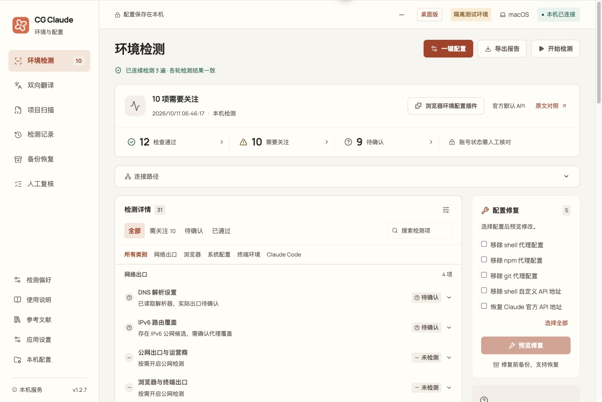
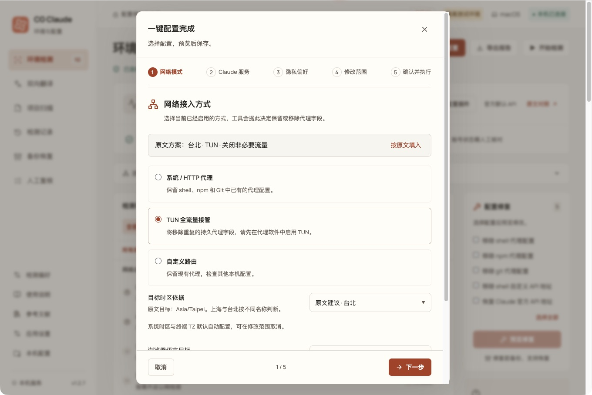
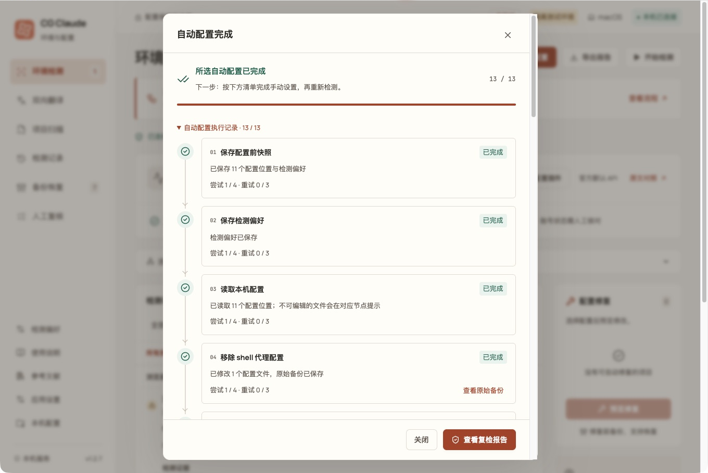
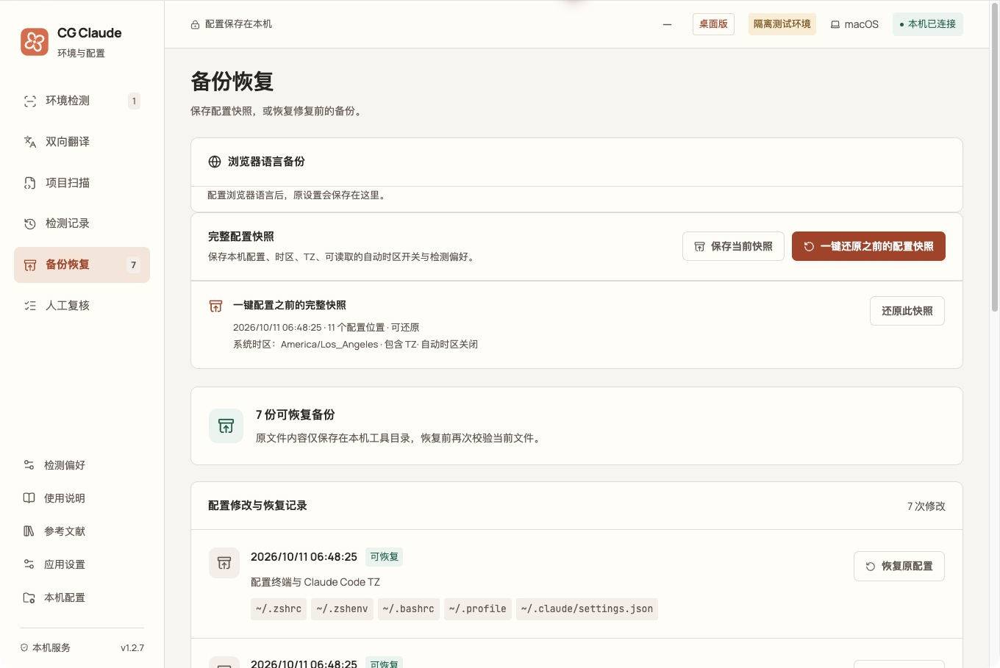
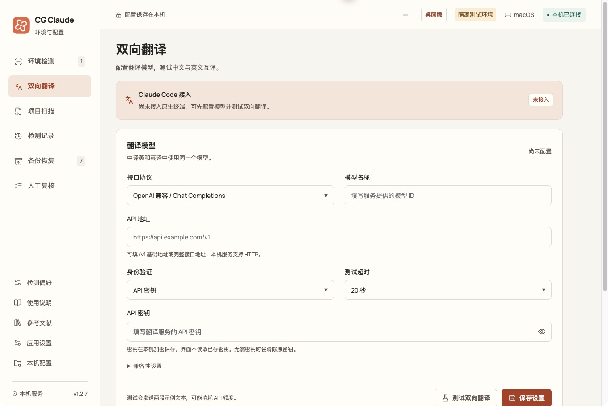
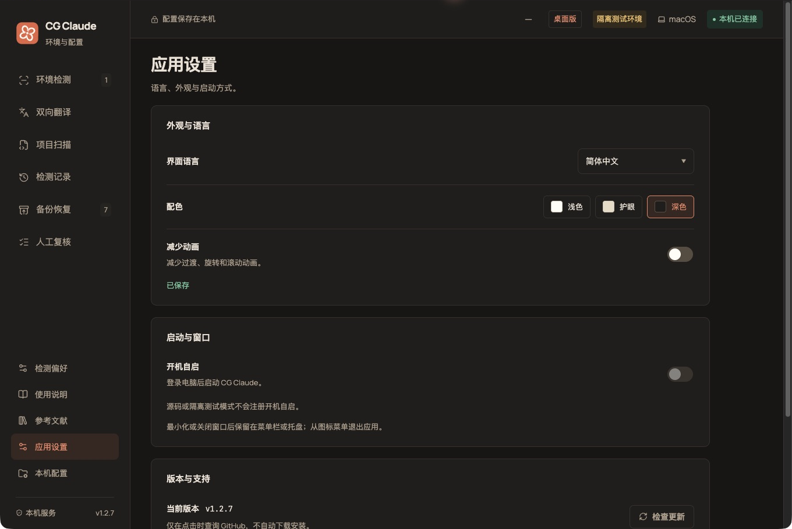

<p align="center">
  
</p>

<h1 align="center">CG Claude</h1>

<p align="center">A local Claude environment checker and configuration tool</p>
<p align="center">v1.2.8 · Electron desktop app · macOS / Windows / Linux</p>

<p align="center">
  <a href="README.md">简体中文</a> · English ·
  <a href="#installation">Installation</a> ·
  <a href="#getting-started">Getting started</a> ·
  <a href="#screenshots">Screenshots</a> ·
  <a href="docs/architecture.md">Development docs</a> ·
  <a href="https://github.com/LcodeCoder/CG-Claude/issues">Report an issue</a>
</p>

CG Claude brings system time zone, terminal environment, browser settings and Claude Code configuration together in one desktop workspace. Check for problems first, review a preview of every change, then save the configuration; restore a snapshot from before the change whenever you need to roll back.



_Actual application UI using an isolated demo directory. Configuration and scan results in the screenshot are examples only._

## What it can do

| Feature              | How to use it                                                                                                                                                                                                                                                                             |
| -------------------- | ----------------------------------------------------------------------------------------------------------------------------------------------------------------------------------------------------------------------------------------------------------------------------------------- |
| Environment scan     | 31 checks, run three times in a row by default. Click “Needs attention” to jump straight to a problem and inspect its evidence, suggested fix and source.                                                                                                                                 |
| One-click setup      | A five-step wizard confirms the target and scope before previewing execution. Thirteen nodes run in order, and each node retries up to three times after its first failure; the workflow still continues to the next item.                                                                |
| Backup and restore   | A backup and a full configuration snapshot are saved before writing. Restore a single change, or preview and restore the complete configuration snapshot.                                                                                                                                 |
| Local configuration  | Edit Claude Code proxy, API endpoint, `NO_PROXY` and extra CA paths. External browser language settings have their own preview, save and restore flow.                                                                                                                                    |
| Project scan         | Choose a local project to review Claude configuration, permissions, hooks, MCP, TLS, credential declarations and lock files. Read-only: project scripts are never executed.                                                                                                               |
| Records and evidence | Keep scan history, export reports and record manual reviews. Built-in source comparison and references let every check link to its supporting material.                                                                                                                                   |
| Translation model    | Configure an OpenAI-compatible or Anthropic endpoint and test Chinese-to-English and English-to-Chinese translation. **Not yet connected to native Claude Code sessions.**                                                                                                                |
| App settings         | Chinese and English UI, light / warm / dark themes, reduced motion, version checks, and menu bar / system tray. Packaged macOS and Windows builds support open at login. The first-run language follows the system locale (`LANG` / `LC_*`); non-Chinese environments default to English. |

The home page also links to the [LC-time browser environment configuration plug-in](https://github.com/LcodeCoder/LC-time) for viewing the plug-in and its installation instructions separately.

## Installation

Go to [GitHub Releases](https://github.com/LcodeCoder/CG-Claude/releases), choose a published version, and download the asset that matches your system and CPU architecture. The desktop build does not require a separate Node.js installation. If no installer is available on the releases page yet, run the project from source as described below.

The current version is **1.2.8**. Installer names are:

| System                | Installer                               | Installation method                                       |
| --------------------- | --------------------------------------- | --------------------------------------------------------- |
| macOS · Apple Silicon | `CG-Claude-1.2.8-macos-arm64.dmg`       | Open the DMG and drag the app into Applications.          |
| macOS · Intel         | `CG-Claude-1.2.8-macos-x64.dmg`         | Open the DMG and drag the app into Applications.          |
| Windows · x64         | `CG-Claude-1.2.8-windows-x64-setup.exe` | Run the installer and follow its prompts.                 |
| Linux · x64           | `CG-Claude-1.2.8-linux-x86_64.AppImage` | Make it executable, then run it directly.                 |
| Debian / Ubuntu · x64 | `CG-Claude-1.2.8-linux-amd64.deb`       | Use the system software installer, or install with `apt`. |

<details>
<summary>Linux launch commands and installer verification</summary>

AppImage:

```sh
chmod +x CG-Claude-1.2.8-linux-x86_64.AppImage
./CG-Claude-1.2.8-linux-x86_64.AppImage
```

Debian / Ubuntu:

```sh
sudo apt install ./CG-Claude-1.2.8-linux-amd64.deb
```

Download `SHA256SUMS.txt` for the same version and verify the files in the installer's directory:

```sh
shasum -a 256 -c SHA256SUMS.txt
```

Windows PowerShell can calculate a single file's checksum for comparison with the manifest:

```powershell
Get-FileHash .\CG-Claude-1.2.8-windows-x64-setup.exe -Algorithm SHA256
```

</details>

The macOS installers are not signed or notarized yet, and the Windows installer has no publisher signature yet. Desktop interaction on Windows and Linux has not been verified on real hardware; see the [release record](docs/release-1.2.8.md) for the verified scope.

### Run from source

Requires **Node.js 22.12 or later**:

```sh
git clone https://github.com/LcodeCoder/CG-Claude.git
cd CG-Claude
npm ci
npm run desktop
```

On macOS you can also double-click `启动工具.command`; on Windows, double-click `启动工具.cmd`. The first run installs dependencies and builds the app.

## Getting started

1. **Choose scan targets.** Set the network mode, service mode and target time zone you actually use under “Scan preferences”, or select them item by item in “One-click setup”.
2. **Start the scan.** Three consecutive passes are run by default and only local configuration is read. Enable public egress or WebRTC checks only when you need to compare network exit information.
3. **Review and resolve issues.** Click “Needs attention” at the top to jump to the details. Automatic changes are previewed first, then backed up and applied after confirmation.
4. **Finish the remaining settings.** After the configuration flow, review the manual checklist: open system settings, copy verification commands or open a terminal as instructed. Reopen the terminal and Claude Code, then scan again.
5. **Restore when needed.** Under “Backups”, select a change record or a full snapshot, review the restore preview and restore it.

After minimizing or closing the desktop window, the app stays in the menu bar or system tray while scans and configuration tasks continue. To quit completely, choose “Quit CG Claude” from the icon menu.

## Screenshots

The screenshots below come from the **1.2.7 macOS desktop build** using isolated demo data; configuration writes only target a temporary directory, and system time zone is simulated. Click a section to expand it.

<details>
<summary><strong>One-click setup: choose each item, preview before executing</strong></summary>

The wizard confirms network mode, Claude service, privacy preferences and change scope in order. The system time zone can be checked against the article's recommendation, the current IP egress, or a manual target.



The execution record shows each node's result and retry count. After configuration, remaining manual steps are collected with settings shortcuts and instructions.



</details>

<details>
<summary><strong>Backup and restore: change records and full configuration snapshots</strong></summary>

Review the backup for a single change, or restore the full snapshot taken before one-click setup. The current file is checked again before restoring; later modifications block overwriting, and the current state is saved before restoring.



</details>

<details>
<summary><strong>Translation model: endpoint, model, key and bidirectional test</strong></summary>

Model configuration lives under “Bidirectional translation”. A test sends only two fixed samples and never reads projects or Claude sessions; the page clearly shows the native terminal integration status.



</details>

<details>
<summary><strong>App settings: dark theme and common preferences</strong></summary>

Chinese and English UI, light / warm / dark themes, reduced motion and version checks are available. Language and appearance are stored locally and persist after reopening the app.



</details>

## Scan and data scope

- **Checks compare actual configuration with the selected target.** Environment checks do not infer account status and do not guarantee account security. Regional availability, signed-in devices, billing and account matters require manual review.
- **Browsers have separate check targets.** Sampling in CG's built-in window only represents the current window. External Chrome, Edge, Firefox or Safari used for sign-in must be checked against the relevant profile or the provided setup guidance.
- **Existing sessions must be reopened.** Changing startup files does not update terminals that are already open; the system time zone, terminal `TZ` and browser time zone are verified separately.
- **Data is stored locally by default.** Records live under `~/.claude-guard/`; backups and snapshots may contain credentials from the original configuration. The UI hides keys, and exported reports additionally hide IP addresses and host names by default.
- **External requests happen only for explicit actions.** Public network checks connect to an egress lookup service; translation tests connect to the model service you configure; version checks query GitHub. They are separate from local read-only scanning.
- **Project scans inspect configuration and metadata.** Full source audits, dependency vulnerability analysis and build verification require separate tools.

See [Scan and configuration notes](docs/local-configuration.md) for complete write rules, snapshot scope, network access and local record details.

## Development

Tech stack: Vue 3, TypeScript, Vite, Electron, Node.js and Zod. The interface, shared types, local services and desktop capabilities live in `src/`, `shared/`, `server/` and `electron/` respectively.

```sh
npm run check        # architecture boundaries, types and tests
npm run format:check # formatting check
npm run pack         # build the application directory
npm run dist         # build an installer for the current platform
```

<details>
<summary>Browser build, isolated demo and read-only CLI</summary>

In a project directory where `npm ci` has already run:

```sh
npm run build
npm start
```

Open `http://127.0.0.1:4318` in a browser. The service listens only on the loopback address; press Ctrl+C to quit. The browser service and the desktop app cannot use the same record directory at the same time.

```sh
npm run demo            # isolated browser demo, default port 4319
npm run desktop:demo    # isolated desktop demo
npm run doctor -- --json # read-only CLI scan
```

`demo` creates example configuration in a temporary directory and requires a completed `npm run build`. `desktop:demo` builds automatically and uses a separate desktop profile directory. Isolated mode does not register open-at-login, and simulates system time zone and `TZ`; platform information and client versions still come from the local machine. Add `--network` to the CLI to enable terminal public-network queries.

| Variable      | Purpose                                                                                                |
| ------------- | ------------------------------------------------------------------------------------------------------ |
| `CG_PORT`     | Browser service port, default 4318; the desktop app uses a random loopback port.                       |
| `CG_HOME`     | Configuration root, defaulting to the current user's home directory; useful for isolated verification. |
| `CG_DATA_DIR` | Record directory, defaulting to `.claude-guard` under the configuration root.                          |
| `CG_DEMO=1`   | Marks isolated mode and should be used with a separate configuration root.                             |

</details>

| Document                                                    | Contents                                                               |
| ----------------------------------------------------------- | ---------------------------------------------------------------------- |
| [Project architecture](docs/architecture.md)                | Layers, code entry points, extending checks and style organization.    |
| [Contributing](CONTRIBUTING.md)                             | Local verification, commit conventions and change requirements.        |
| [Scan and configuration notes](docs/local-configuration.md) | Repair flow, configuration scope, snapshots and local data.            |
| [Article-by-article comparison](docs/article-audit.md)      | Mapping of 43 article requirements to checks, fixes and manual review. |
| [Reference audit](docs/reference-audit.md)                  | What was adopted from 69 sources and the boundaries of their use.      |
| [Time zone detection notes](docs/timezone-detection.md)     | Evidence sources for system, process and browser time zones.           |
| [Validation record](docs/validation.md)                     | Validation rounds, actual tests and uncovered areas.                   |
| [Publishing notes](docs/publishing.md)                      | Multi-platform builds, checksums and the GitHub Release flow.          |

Installers are distributed as GitHub Release assets; binary artifacts are not committed to the source repository. The `Check` workflow verifies all three operating systems; `Build installers` builds installers on native platforms and uploads Artifacts, while releases are published by the maintainer.

[View releases](https://github.com/LcodeCoder/CG-Claude/releases) · [Report an issue](https://github.com/LcodeCoder/CG-Claude/issues) · [Star the project](https://github.com/LcodeCoder/CG-Claude)

## Community and acknowledgements

Thanks to [LINUX DO](https://linux.do/) for providing a place for technical exchange and shared experience, and to the community members who share their knowledge.

Feel free to discuss CG Claude in the [LINUX DO community](https://linux.do/). For bugs or feature ideas, you can also open an issue on [GitHub Issues](https://github.com/LcodeCoder/CG-Claude/issues).
