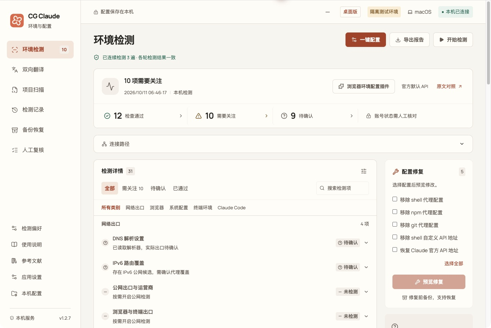
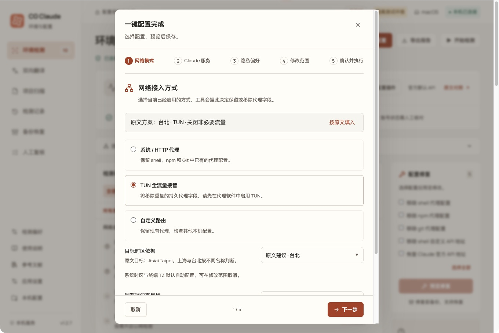
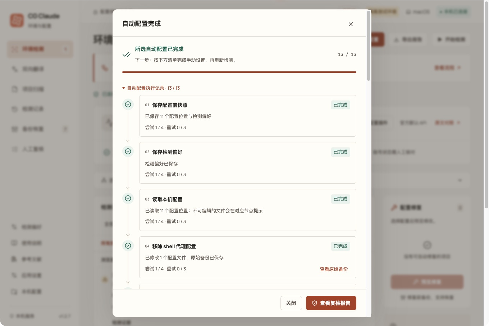
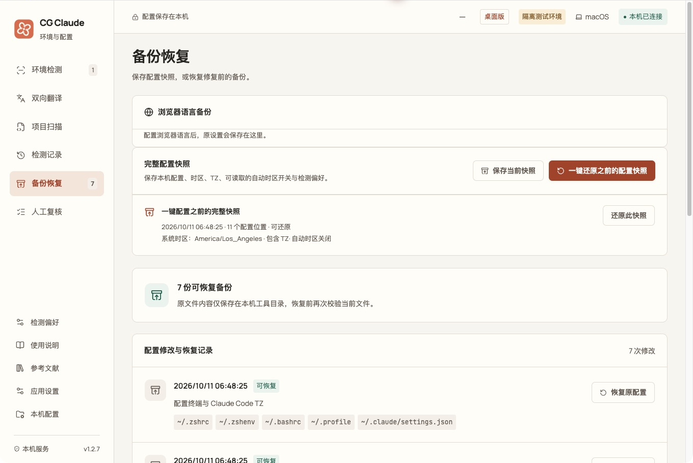
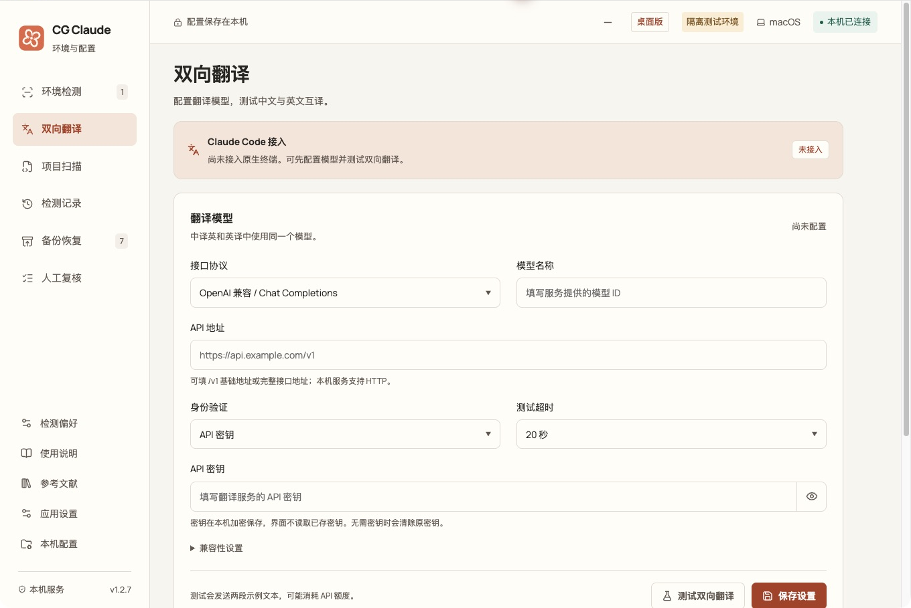
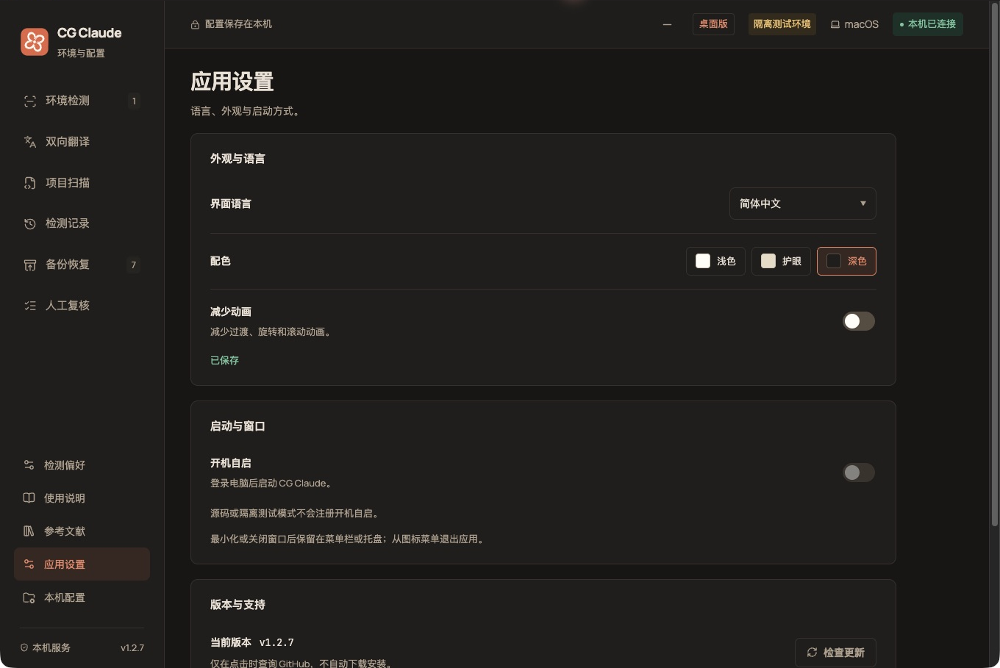

<p align="center">
  
</p>

<h1 align="center">CG Claude</h1>

<p align="center">本地 Claude 环境检测与配置工具</p>
<p align="center">v1.2.7 · Electron 桌面应用 · macOS / Windows / Linux</p>

<p align="center">
  <a href="#安装">安装</a> ·
  <a href="#第一次使用">开始使用</a> ·
  <a href="#应用截图">应用截图</a> ·
  <a href="docs/architecture.md">开发文档</a> ·
  <a href="https://github.com/LcodeCoder/CG-Claude/issues">问题反馈</a>
</p>

CG Claude 把系统时区、终端环境、浏览器设置和 Claude Code 配置集中到一个桌面工作台。先检测问题、查看修改预览，再保存配置；需要回退时，可以恢复修改前的快照。



_实际应用界面，使用独立演示目录。截图中的配置与检测结果仅作示例。_

## 可以做什么

| 功能       | 使用方式                                                                                                            |
| ---------- | ------------------------------------------------------------------------------------------------------------------- |
| 环境检测   | 31 项检查，默认连续检测 3 遍。点击「需要关注」直接定位问题，展开查看证据、处理方法和来源。                          |
| 一键配置   | 5 步向导先确认目标和修改范围，再预览执行。13 个节点依次处理，每个节点首次失败后最多重试 3 次；仍失败则继续下一项。  |
| 备份恢复   | 写入前自动备份并保存完整配置快照。可恢复单次修改，或预览后还原整份配置快照。                                        |
| 本机配置   | 编辑 Claude Code 的代理、API 地址、NO_PROXY 和额外 CA 路径；外部浏览器语言配置提供独立预览、保存与还原。            |
| 项目扫描   | 选择本地项目，核对 Claude 配置、权限、Hooks、MCP、TLS、凭据声明与锁文件。只读扫描，不执行项目脚本。                 |
| 记录与依据 | 保留检测历史、导出报告、记录人工复核。内置原文对照与参考文献，可从检测项跳到对应来源。                              |
| 翻译模型   | 配置 OpenAI 兼容或 Anthropic 接口，测试中译英、英译中。**当前尚未接入 Claude Code 原生会话。**                      |
| 应用设置   | 中英文界面、浅色／护眼／深色配色、减少动画、版本检查，以及菜单栏／系统托盘。打包的 macOS / Windows 版支持开机自启。 |

首页还提供 [LC-time 浏览器环境配置插件](https://github.com/LcodeCoder/LC-time) 入口，方便单独查看浏览器插件及安装说明。

## 安装

前往 [GitHub Releases](https://github.com/LcodeCoder/CG-Claude/releases) 选择已发布版本，下载与你的系统和 CPU 架构对应的附件。安装桌面版后，无需另外安装 Node.js。若发布页暂未提供安装包，可以先按下方「源码启动」运行。

当前版本为 **1.2.7**，安装包命名如下：

| 系统                  | 安装包                                  | 安装方式                                |
| --------------------- | --------------------------------------- | --------------------------------------- |
| macOS · Apple Silicon | `CG-Claude-1.2.7-macos-arm64.dmg`       | 打开 DMG，将应用拖入「应用程序」。      |
| macOS · Intel         | `CG-Claude-1.2.7-macos-x64.dmg`         | 打开 DMG，将应用拖入「应用程序」。      |
| Windows · x64         | `CG-Claude-1.2.7-windows-x64-setup.exe` | 运行安装程序，按提示完成安装。          |
| Linux · x64           | `CG-Claude-1.2.7-linux-x86_64.AppImage` | 添加执行权限后直接运行。                |
| Debian / Ubuntu · x64 | `CG-Claude-1.2.7-linux-amd64.deb`       | 使用系统软件安装器，或通过 `apt` 安装。 |

<details>
<summary>Linux 启动命令与安装包校验</summary>

AppImage：

```sh
chmod +x CG-Claude-1.2.7-linux-x86_64.AppImage
./CG-Claude-1.2.7-linux-x86_64.AppImage
```

Debian / Ubuntu：

```sh
sudo apt install ./CG-Claude-1.2.7-linux-amd64.deb
```

下载同一版本的 `SHA256SUMS.txt`，在安装包所在目录核对文件完整性：

```sh
shasum -a 256 -c SHA256SUMS.txt
```

Windows PowerShell 可计算单个文件的校验值，与清单对照：

```powershell
Get-FileHash .\CG-Claude-1.2.7-windows-x64-setup.exe -Algorithm SHA256
```

</details>

macOS 安装包尚未签名、公证，Windows 安装包尚未进行发布者签名。Windows / Linux 的桌面交互尚未实机验证，已验证范围见 [交付记录](docs/release-1.2.7.md)。

### 源码启动

需要 **Node.js 22.12 或更新版本**：

```sh
git clone https://github.com/LcodeCoder/CG-Claude.git
cd CG-Claude
npm ci
npm run desktop
```

macOS 也可双击 `启动工具.command`，Windows 可双击 `启动工具.cmd`；首次运行需要安装依赖并构建应用。

## 第一次使用

1. **选择检测目标。** 在「检测偏好」设置实际使用的网络模式、服务方式与目标时区；也可以在「一键配置」中逐项选择。
2. **开始检测。** 默认连续检查 3 遍，仅读取本机配置。需要比较公网出口或 WebRTC 时，再勾选对应网络检测。
3. **查看并处理问题。** 点击顶部「需要关注」定位详情。自动修改先展示预览，确认后备份并执行。
4. **完成剩余设置。** 配置结束后查看手动清单，按步骤打开系统设置、复制核对命令或打开终端。重新打开终端与 Claude Code 后再次检测。
5. **需要时恢复。** 在「备份恢复」选择修改记录或完整快照，查看还原预览后恢复。

最小化或关闭桌面窗口后，应用留在菜单栏／系统托盘，检测与配置任务继续执行。需要完全退出时，从图标菜单选择「退出 CG Claude」。

## 应用截图

以下截图来自 **1.2.7 macOS 桌面版**，使用隔离演示数据；配置写入只作用于临时目录，系统时区使用模拟状态。点击展开查看完整界面。

<details>
<summary><strong>一键配置：逐项选择，先预览再执行</strong></summary>

向导依次确认网络模式、Claude 服务、隐私偏好与修改范围。系统时区可以按文章建议、当前 IP 出口或手动目标核对。



执行记录显示每个节点的结果和重试次数。配置完成后，仍需手动处理的事项集中列出，并提供设置入口与操作步骤。



</details>

<details>
<summary><strong>备份恢复：保留修改记录与完整配置快照</strong></summary>

可以查看单次修改的备份，或还原一键配置前的完整快照。还原前再次核对当前文件；有后续修改时会阻止覆盖，并在还原前保存当前状态。



</details>

<details>
<summary><strong>翻译模型：接口、模型、密钥与双向测试</strong></summary>

模型配置集中在「双向翻译」导航中。测试只发送两段固定示例，不读取项目或 Claude 会话；页面明确显示原生终端的接入状态。



</details>

<details>
<summary><strong>应用设置：深色模式与常用偏好</strong></summary>

提供中英文界面、浅色／护眼／深色配色、减少动画和版本检查。语言与外观保存在本机，重新打开后仍保留。



</details>

## 检测与数据范围

- **检测按实际配置与所选目标判断。** 环境检查不推算账号状态，也不保证账号安全；地区支持、登录设备、计费与账号事项需要人工核对。
- **浏览器有独立的检测对象。** CG 内置窗口的采样只代表当前窗口。用于登录的外部 Chrome、Edge、Firefox 或 Safari，需要选择对应资料或按提供的设置指引另外核对。
- **已有会话需要重新打开。** 修改启动文件不会更新已经打开的终端进程；系统时区、终端 TZ 与浏览器时区分别复检。
- **数据默认保存在本机。** 记录位于 `~/.claude-guard/`；备份与快照可能包含原配置中的凭据。界面隐藏密钥，报告导出默认进一步隐藏 IP 与主机名。
- **外部请求按操作发起。** 公网检测会连接出口查询服务；翻译测试连接你配置的模型服务；版本检查查询 GitHub。它们与本机只读检测分别开启。
- **项目扫描检查配置与元数据。** 完整源码审计、依赖漏洞分析和构建验证需要另行使用相应工具。

完整的写入规则、快照覆盖范围、网络访问与本机记录说明见 [检测与配置说明](docs/local-configuration.md)。

## 开发与文档

技术栈：Vue 3、TypeScript、Vite、Electron、Node.js 与 Zod。界面、共享类型、本机服务和桌面能力分别位于 `src/`、`shared/`、`server/`、`electron/`。

```sh
npm run check        # 架构边界、类型与测试
npm run format:check # 格式检查
npm run pack         # 生成应用目录
npm run dist         # 生成当前平台安装包
```

<details>
<summary>浏览器版、隔离演示与只读 CLI</summary>

在已经运行 `npm ci` 的项目目录中：

```sh
npm run build
npm start
```

浏览器访问 `http://127.0.0.1:4318`。服务只监听回环地址，使用 Ctrl+C 退出。同一记录目录不能同时运行浏览器服务与桌面版。

```sh
npm run demo            # 隔离浏览器演示，默认端口 4319
npm run desktop:demo    # 隔离桌面演示
npm run doctor -- --json # 只读 CLI 检测
```

`demo` 在临时目录中创建示例配置，需先完成 `npm run build`。`desktop:demo` 自动构建，使用独立桌面资料目录。隔离模式不注册开机自启，系统时区与 TZ 使用模拟状态；平台信息及客户端版本仍按本机读取。CLI 加上 `--network` 可开启终端公网查询。

| 运行变量      | 用途                                                |
| ------------- | --------------------------------------------------- |
| `CG_PORT`     | 浏览器服务端口，默认 4318；桌面版使用随机回环端口。 |
| `CG_HOME`     | 配置根目录，默认当前用户主目录；可用于隔离验证。    |
| `CG_DATA_DIR` | 记录目录，默认配置根目录下 `.claude-guard`。        |
| `CG_DEMO=1`   | 标记隔离模式，应同时指定独立配置根目录。            |

</details>

| 文档                                          | 内容                                       |
| --------------------------------------------- | ------------------------------------------ |
| [项目架构](docs/architecture.md)              | 分层、代码入口、检查扩展与样式组织。       |
| [参与开发](CONTRIBUTING.md)                   | 本地验证、提交约定与改动要求。             |
| [检测与配置说明](docs/local-configuration.md) | 修复流程、配置范围、快照与本机数据。       |
| [原文逐项对照](docs/article-audit.md)         | 43 项文章要求的检测、修复与人工核对映射。  |
| [参考文献审计](docs/reference-audit.md)       | 69 条来源的采用内容与适用边界。            |
| [时区检测说明](docs/timezone-detection.md)    | 系统、进程与浏览器时区的证据来源。         |
| [验证记录](docs/validation.md)                | 各轮验收、实际测试与未覆盖范围。           |
| [发布说明](docs/publishing.md)                | 多平台构建、校验值与 GitHub Release 流程。 |

安装包通过 GitHub Release 附件分发，源码仓库不提交二进制产物。`Check` 工作流验证三个系统；`Build installers` 在原生平台构建安装包并上传 Artifacts，正式 Release 由维护者发布。

[查看版本](https://github.com/LcodeCoder/CG-Claude/releases) · [报告问题](https://github.com/LcodeCoder/CG-Claude/issues) · [给项目一个 Star](https://github.com/LcodeCoder/CG-Claude)

## 社区与鸣谢

感谢 [LINUX DO](https://linux.do/) 提供技术交流与经验分享的平台，也感谢社区里乐于分享的佬友。

欢迎在 [LINUX DO 社区](https://linux.do/) 交流 CG Claude 的使用体验。遇到问题或有功能建议，也可以提交到 [GitHub Issues](https://github.com/LcodeCoder/CG-Claude/issues)。
