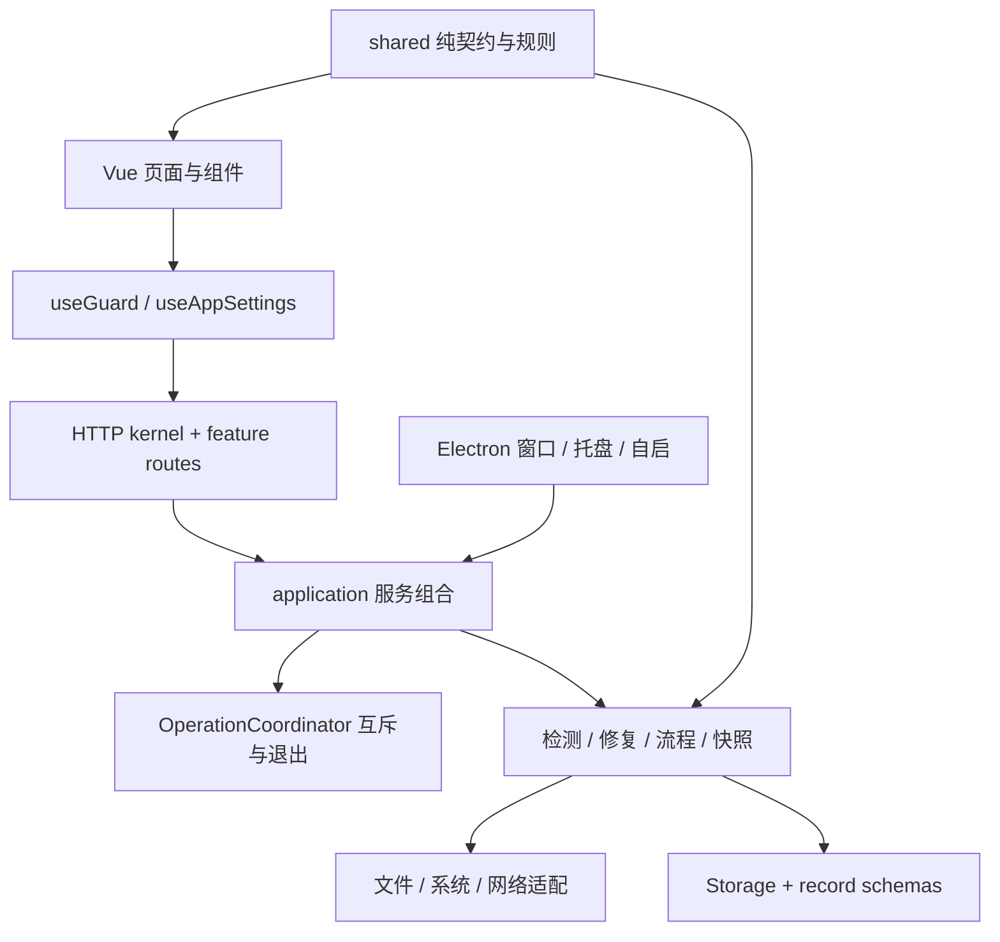

# 项目结构与扩展指南

CG Claude 是一个本地应用。Vue 展示事实、收集选择和预览修改；Node 服务负责固定范围的读取与事务；Electron 提供窗口、目录选择和原生导出。前端不直接读写文件。

## 从哪里开始读

| 要处理的工作         | 入口与职责                                                                                                                                               |
| -------------------- | -------------------------------------------------------------------------------------------------------------------------------------------------------- |
| 导航与全局弹窗       | `src/App.vue` 组合页面；`src/content/navigation.ts` 是统一注册点。本机配置放在导航最后                                                                   |
| 环境功能的公共接口   | `src/composables/useGuard.ts` 是薄 facade；`guard/context.ts` 管状态与刷新；其余文件按检测、修复、连接、浏览器语言、翻译、记录、快照、项目、偏好分别管理 |
| 后台任务恢复         | `guard/monitors.ts` 用轮询与 generation 校验阻止旧请求覆盖新状态；服务重连会清理已经完成的占用状态                                                       |
| 应用偏好             | `useAppSettings.ts` 管语言、外观和版本查询；与检测偏好、配置快照分开                                                                                     |
| 页面与复用组件       | `src/views/` 负责页面，`src/components/` 负责呈现与事件。非首屏页面按需加载                                                                              |
| 界面本地化           | `src/i18n/` 保存界面词条；在显示边界调用 `t`，不修改配置请求、代码、路径、用户输入和原文引用                                                             |
| 服务创建与 HTTP 监听 | `server/index.ts` 仅装配、监听与 CLI 入口；`application.ts` 组合业务服务及生命周期                                                                       |
| HTTP 边界            | `http/kernel.ts` 统一 Host、Origin、token、请求大小、错误与静态文件；`http/routes/` 按诊断、配置、记录、流程组织端点                                     |
| 任务互斥与退出等待   | `server/operations.ts` 跟踪进行中的 Promise；写入、检测与配置流程共享占用，退出等待当前任务                                                              |
| 环境检查编排         | `diagnostics.ts` 组合规则；`system-snapshot.ts`、`network-diagnostics.ts` 负责系统与网络取证                                                             |
| 专项规则             | `timezone-diagnostics.ts`、`cli-diagnostics.ts`、`configuration-diagnostics.ts`、`privacy-diagnostics.ts` 等返回检查结果                                 |
| 本地读写与回退       | `configs.ts` 解析；`safety.ts` 限定路径和原子写入；`repairs.ts`、`snapshots.ts` 处理预览、冲突校验、备份与回退                                           |
| 持久化边界           | `storage.ts` 与 `*-record.ts` 校验数据。记录层不反向导入翻译、修复、浏览器语言等业务模块                                                                 |
| 固定系统命令         | `commands.ts`、`command-environment.ts`、`timezone-settings.ts`、`local-actions.ts`；不接受任意命令或外部路径                                            |
| 桌面功能             | `electron/main.ts`、`tray.ts`、`startup.ts`；preload 是 `electron/preload.cjs`，只暴露有限的可信窗口操作                                                 |
| 版本查询             | `version-check.ts` 只访问固定项目的公开正式 Release，不把最新 commit 当成可下载版本                                                                      |
| 稳定 ID 与文献       | `shared/diagnostic-checks.ts`、`references.ts`、`manual-guidance.ts`，连接检测、历史、详情和依据                                                         |

页面通过类型化的 props、model 和事件与 App 交互；文件与系统写入始终在服务端。新增功能复用公共 composable，避免复制 API、互斥、预览过期或恢复逻辑。

## 分层约束

- `shared` 仅依赖共享模块和 Zod，保持浏览器与服务端通用。
- `src` 可以依赖 `shared`，不能导入服务端、Electron 或 Node 本机接口。
- `server` 可以依赖 `shared`，不能依赖 Vue 页面或 Electron。
- Electron 组合本机服务；仅可信主窗口可调用固定 IPC。
- 视图不能绕过 facade 直接调用 `guard/` 内部模块；持久化层不能依赖业务服务。
- 生产代码不允许运行时循环依赖，纯类型依赖另行处理。

`npm run architecture:check` 用 TypeScript AST 扫描全部生产模块，检查上述边界与循环。它已加入 `npm run check` 和三平台 CI；类型检查、架构检查和测试共同执行。编译产物、测试夹具与脚本不属于生产依赖图。

## 一次修改如何流动

1. 页面发送已选择的有限字段，公共 composable 调用本机 API。
2. HTTP 边界检查来源、token、JSON 大小和 schema。
3. `OperationCoordinator` 获得独占使用权；业务服务读当前状态并生成预览。
4. 用户审阅后提交预览 ID，服务重新验证基线、保存快照与备份，再执行原子修改。
5. 结果已确认时，前端立即使旧修复基线失效，再刷新 bootstrap。后续刷新失败不会撤销已确认成功的文案。
6. 客户端断开或窗口隐藏不提前结束服务事务。明确退出等待操作完成后释放记录目录租约。

## 翻译模型与浏览器语言

翻译模型入口为 `src/views/TranslationView.vue` 和 `src/components/TranslationModelSettings.vue`；`shared/translation.ts` 定义有限字段、协议、规范化接口地址和固定测试示例。`server/translation.ts` 实现模型设置、凭据加密与双向测试，本机 API 复用 Host/Origin/token 和修改互斥。测试不保存草稿，也不安装 Claude Code 插件或钩子。

密钥采用 AES-256-GCM，AAD 绑定协议和规范化接口地址；更换目标不会复用旧密钥。`Storage` 原子写入密文设置，主密钥以独占创建方式保存；读取拒绝符号链接、硬链接及不合适的 POSIX 权限。主密钥与密文都在用户数据目录中，不宣称是系统钥匙串。完整环境快照仍只涵盖固定用户配置位置、检测偏好和时区状态，不覆盖翻译服务设置。

翻译测试通过服务进程的 HTTP(S)_PROXY 和 NO_PROXY，回环地址直连；证书校验启用，重定向拒绝。请求有整体超时，实际读取响应有 128 KB 上限；只提取正文、检测截断和目标语言，不重试可能计费的请求。结果仅验证接口与固定示例，不能证明翻译语义质量。

浏览器语言由 `src/composables/browser.ts` 采集 `navigator.language` 和 `navigator.languages`，`server/browser-language.ts` 使用用户选择的目标独立判断，不能从时区通过推算语言通过。设置指引在 `src/components/BrowserLanguagePreferences.vue`。外部浏览器需要分别检查；不修改运行中的浏览器资料文件。

系统时区写入由 `server/timezone-settings.ts` 进行有限等待复核。流程把本次写入尝试独立记录在预览状态中；仅当目标与本次已审阅操作一致且其他时区层未变化时同步基线。已获确认的命令在重试时只复核，不重复请求管理员授权。历史流程结果保留当时观察到的状态。

## 新增一项检查

1. 先在官方或项目原文核对检查的依据、适用版本和读取范围。
2. 在 `shared/diagnostic-checks.ts` 注册稳定 ID；总检查数由列表推导，修改判断含义时更新规则版本。
3. 用独立规则函数返回 `CheckResult`。状态要区分明确问题、待确认和未检测；缺少读取权限、动态表达式或未知版本不能返回假通过。
4. 在 `server/diagnostics.ts` 的对应读取阶段加入结果。复用已读配置，避免重复执行本机命令；固定参数，不执行用户脚本。
5. 在 `shared/references.ts` 添加来源和 `checkIds`。文献会自动关联详情，Electron 的外链主机白名单也从这里生成。
6. 为重要判断和失败边界补充测试。使用 `tests/fixtures.ts` 的临时根目录，不依赖维护者真实代理、账号或配置。
7. 验证三遍检测、统计数量和历史比较。更新 README 的能力描述和 `docs/validation.md` 的实际结果。

## 扩展可修改配置

修改必须有可读预览、原始备份、预览后冲突校验和异常回退。修复只修改选择的字段，保留其他键、注释和文件权限；无法可靠解析的内容交给人工核对。完整快照还要保存缺失状态和检测偏好，恢复前再保存当前状态。

配置目标集中在 `server/context.ts`，输入 schema 在 `shared/types.ts`，字段转换在 `server/configs.ts`，事务在 `server/repairs.ts`。增加可修复字段时同步检查 ID、FixId、界面说明与恢复测试，避免前端自行拼接任意路径或命令。

连接编辑使用独立的有限字段 schema 和 plan kind，仍复用 RepairEngine 的预览、冲突校验、备份、写入与回退。保存前由 SnapshotEngine 捕获完整配置基线；普通修复端点不能消费连接预览而绕过快照。CA 元数据在预览与写入前分别验证。

报告的 `configurationFingerprint` 由固定配置的内容校验、权限和读取状态计算；bootstrap 提供当前基线。前端遇到配置已变化或缺基线的旧报告时要求重新检测。默认导出移除基线指纹，避免把配置内容的摘要标识带到外部。

## 样式与品牌

`src/styles/tokens.css` 是配色和字体变量入口。`src/style.css` 只维护顺序导入：基础、布局、检测、数据页面、弹窗、响应式、配置流程、项目/快照、阅读微调。拆分时保留了原样式节点顺序，最后的阅读调整继续覆盖前面的共用规则。文献、人工复核与历史比较有独立的页面样式文件。

新样式优先使用变量，正文用深色，说明文字保持可读对比度；长路径、变量名和证据要能换行。使用真实空状态、禁用状态和焦点样式。验证默认 Electron 窗口、较矮窗口、390px 窄窗以及键盘操作。

原创 Logo 的唯一源文件是 `public/logo.svg`。执行 `npm run icons` 生成 PNG、ICNS 和 ICO；不要分别手动编辑各个平台图标。

## 数据与兼容性

报告、备份、快照、流程与复核记录存在用户本机。原始配置可能包含凭据，不能进入截图、公开日志或仓库。报告只保存脱敏证据，导出默认继续隐藏 IP 与主机标识。

新字段要兼容旧记录：例如报告的 `ruleset` 为可选字段，旧记录可以阅读且比较时提示规则来源不完整。每份记录的时间表达实际发生的动作，导入旧复核勾选时不能伪造历史确认时间。

项目固定文件清单与元数据/内容读取在 `server/project-files.ts`。内容上限与文件描述符检查在 `server/file-reading.ts`；用户配置和项目配置共用这条读取路径。文献的环境检查 ID 与项目检查 ID 分开保存，双向跳转按范围定位。

配置事务记录原文件 mode 和实际写入后的 `afterMode`。Windows 的权限映射可能改变 POSIX 数值，因此还原必须使用观测到的写后权限核对冲突。旧备份缺少 `afterMode` 时继续使用原 mode；不要通过跳过权限检查解决平台差异。

环境详情在 `src/views/EnvironmentView.vue`，筛选模型在 `src/lib/environment-results.ts`。

错误排查内容在 `src/content/troubleshooting.ts`，交互组件在 `src/components/TroubleshootingGuide.vue`。内容只引用稳定检查 ID 和文献源 ID，由 App 接收事件并导航。帮助页不执行账号请求；没有检测报告时先打开检测选项。

环境首页由 `src/views/EnvironmentView.vue` 维护统计、连接路径、详情筛选和修复选择；App 只连接页面与本机操作。筛选模型在 `src/lib/environment-results.ts`，由 App 保存，所以跨页返回时搜索和展开状态仍保留。统计导航等待父级 model 更新后再读取目标列表，避免跳到旧筛选中的节点。详情、项目和帮助页共用 `src/lib/navigation.ts` 的焦点与滚动逻辑。

主导航和页面说明在 `src/content/navigation.ts` 注册。新增页面先补齐标题、说明和稳定 ID，再接入视图；不要在主模板继续叠加文案条件分支。

文献关联分别使用 `checkIds`、`projectCheckIds` 和带类型的 `manualItemIds`；来源单条、检查、项目与人工复核四种筛选范围明确区分。人工复核事项注册在 `shared/types.ts`，其稳定 ID 用于保存记录和双向定位。

配置与项目文本共用 `server/file-reading.ts`：读取同一文件描述符、约束实际字节数、校验读取期间变化，然后严格解码 UTF-8。BOM 不被丢弃，便于原字节还原。非法 UTF-8 和 NUL 字节产生不含原内容的 `FileReadError`；本机配置不可编辑、项目结果显示读取错误、快照列入排除项。不要通过宽松解码或猜测编码继续写入。

一键配置的每个文件基线使用 `configurationState`，同时记录内容散列、权限、可编辑状态和读取错误。预览结束、创建任务、保存快照和执行节点前都要匹配基线。修复事务的 `applyWithState` 返回写入时已知的状态，包含 Windows 实际应用的权限；流程据此更新基线，不重新读取当前文件并把外部修改当成已授权结果。普通 API 仍只返回脱敏的备份摘要。

项目命令沙箱检查在 `server/sandbox-diagnostics.ts`，接收已解析的单份设置声明，输出有限证据；不读取额外文件或执行命令。新增字段须先核对版本与配置范围，不使用未知值来推断有效隔离。项目列表与文献入口复用 `src/lib/project-results.ts` 的标签函数，区分共享项目设置与项目本地设置。

## 系统指令的边界

系统探测默认使用 `execFile` 与独立参数数组。Windows 仅在原生程序启动返回 ENOENT / EINVAL 时，允许三个固定只读指令回退到 `cmd.exe /d /s /c`：Claude 版本和 npm 的两种代理查询。项目路径、用户字段与额外参数不能进入该回退；指令已执行后失败或超时不会重跑。子进程继承隔离 HOME / USERPROFILE 与超时预算，并设置 `NoDefaultCurrentDirectoryInExePath` 防止批处理隐式优先搜索当前目录。

## 服务与认证名称的注册

`shared/usage-modes.ts` 统一定义服务 ID、显示名称与保留说明，供偏好校验、设置页、配置向导和报告使用。增加服务时更新这个注册表，避免多个页面使用不同名字。

`shared/authentication.ts` 只记录认证、提供商和上下文字段的名称，不存储值。服务端的 shell 识别与认证检查共同使用它；新增身份字段必须同时验证配置预览和报告脱敏。Foundry 的资源名称只做字面形态检查，动态表达式仍待确认。宿主管理声明不能证明实际会话已经使用该路由，需要在客户端核对。

## 检测与事务弹窗

App 负责选择记录和调用操作，ScanOptionsDialog、RepairPreviewDialog、SnapshotRestoreDialog、RestoreBackupDialog 负责各自的展示。弹窗只通过类型明确的事件请求操作，文件写入、任务互斥和冲突校验仍由 useGuard 与服务端承担。共同的模态行为由 GuardDialog 管理。修改文案或预览排版时可以只阅读对应组件，避免在 App 中查找多段事务模板。

配置目录作用范围由 `server/configuration-scope.ts` 统一判断。仅比较当前进程和默认用户文件中的声明，不执行 shell、不扩展变量、不读取外部目录。检测来源、连接编辑和自动修复共用该判断；执行阶段再次校验，避免预览后目录范围改变。Windows 按自身路径语义比较大小写与分隔符。

## 原文与文献审计

`shared/article-audit.ts` 注册原文各节要求、自动覆盖范围、修复方式和稳定检查 ID。`shared/reference-audit.ts` 记录每条文献实际采用的段落及代码位置，`ArticleAuditPanel.vue` 展示当前模式与原文的差异并接入精确跳转。新增来源时同步这两份数据，再运行 `npm run docs:audit` 生成审计文档；不要把已有检查通过当成满足原文全文。

系统时区取证在 `server/system-timezone.ts`，目标与证据判断在 `server/timezone-diagnostics.ts`。Git TLS 的布尔语义在 `server/git-tls.ts`，用户和项目作用域分别核对，include 与无效值保留未知；Git TLS 不自动改写。系统时区配置使用下面的独立授权事务。

## 时区配置事务

`server/timezone-settings.ts` 集中管理各平台的有限命令、独立系统读取、用户 TZ 与快照状态。`server/timezone-config.ts` 只转换白名单文件中的 TZ，`server/setup-timezone.ts` 负责两个节点的预览和配置。Context 暴露可注入的读写适配器；demo 和测试使用内存模拟，避免触碰真实系统和全局 process.env。

一键预览冻结有效目标及文件、时区基线。文件事务继续复用 RepairEngine；系统写入要求配置前快照，成功必须经独立读数复核。快照将时区状态与校验值保存在本地私有记录中，摘要不返回旧 TZ 原文；还原检查时区漂移，并防止失败回退覆盖第三方新时区。旧记录缺少时区字段时兼容其原范围。

最终复检通过一次性 `browserProbeId` 请求新的渲染器采样。受本机 token 与 origin 检查保护的回传接口只接受当前任务待采样的 token，可以在流程占用写入锁时接收样本；它不写配置。超时不复用旧浏览器数据，重放请求被拒绝。配置过程的授权密码由操作系统处理，不存在应用密码输入或存储字段。

## 本机记录与长操作状态

`server/record-validation.ts` 定义记录的持久化边界。读取使用 `readBoundedText` 的文件描述符和实际字节限制，拒绝特殊文件、无效编码与符号链接。记录结构错误会报告文件名并保留原文件；不得按空集合继续写入。快照的整体校验覆盖配置原文、目标路径、权限、偏好和时区状态，备份覆盖全部文件还原输入；旧记录保留原有字段并继续核对原文散列。校验用于发现损坏，不是签名或防止本机攻击者重算校验值的机制。对象键以固定顺序计算校验，数组与配置原文保留顺序。持久化校验和结构校验通过后，再为归一化的旧记录计算内存校验值；合法的迁移保存不因字段顺序或默认值补齐而失败。检测偏好按字段值比较，不依赖 JSON 的键排列。

`shared/service-status.ts` 统一检测任务与本机活动的契约。`/api/status` 只读当前内存状态，不重复读取配置；bootstrap 携带正在执行的检测。界面刷新后接回检测或配置轮询，其他本机操作仍占用界面写入锁。退出服务时跟踪完整的修改 Promise，客户端断开不能提前释放记录目录租约。

`src/lib/local-api.ts` 集中处理网络请求、短读超时和管理员授权所需的较长写入预算。`useGuard` 区分操作已确认完成与后续界面刷新失败，成功写入立即使旧报告的修复基线失效。未收到结果只报告待核对，不能宣称没有修改。

## 桌面托盘

`electron/tray.ts` 管理图标、菜单、任务状态和窗口隐藏规则。图标来自 `public/tray.svg`；生成脚本输出 macOS Template/Retina、Windows ICO 和 Linux PNG，并随应用打包。最小化和关闭窗口保留渲染器，新浏览器复检仍可回传；明确退出等待后台事务后销毁托盘。Linux 桌面不支持托盘时保留普通最小化与关闭行为。IPC 仅允许同一本机主窗口调用隐藏与目录选择。

## 原文操作指引与独立配置目标

`shared/manual-guidance.ts` 是人工复核页和一键配置完成页的共同指引来源，集中保存原文章节、操作步骤、固定设置动作和验证命令。`SetupFollowupList` 仅负责展示，`ManualActionGuide` 复用折叠详情和复制交互。完成页选择本次任务之后、检测偏好相同的最新报告；旧勾选不能消除本次任务，新的人工确认也不能隐藏机器观察到的告警。按出口选择时区却尚无有效出口证据时，指引提示先复检，不退回台北。

`shared/local-actions.ts` 和 `server/local-actions.ts` 只接受日期与时间、定位服务、网络设置和空终端这四个固定 ID，不接收任意 URL、路径或命令。API 复用 Host / Origin / token 校验。定位跳转只保证进入可支持的上层页，系统服务详情由本人打开。命令只提供复制，不自动粘贴或执行。演示模式返回未打开，避免误报成功。

`server/timezone-automation.ts` 单独读取 macOS 自动时区偏好。未知不视作关闭；定位记录存在不视作权限已关闭。配置步骤先确认可读的系统时区基线，再关闭已知开启的自动时区；写入回读容忍短暂延迟，授权成功时不因延迟重复弹授权。`timezoneState` 和快照摘要包含可读取的原开关；旧快照缺少该字段时不推断或修改它。

`server/browser-configuration.ts` 根据当前用户目录下的固定 Chrome / Edge / Brave / Chromium 根目录重建可选资料，渲染端只能提交不透明资料 ID。写入前要求浏览器完全退出，校验文件内容和权限，原子替换并回读。仅备份语言字段，拒绝链接、异常类型和已观察到的强制语言；恢复保留无关配置与用户后续修改。macOS 可选应用语言影响该浏览器所有资料，网页首选语言只改选中资料。旧资料没有 `selected_languages` 时，同时备份 `accept_languages`，避免浏览器启动迁移破坏还原。写入结果只报告已保存，实际页面语言须重开同一浏览器复检。

`server/command-environment.ts` 为从桌面启动的 macOS / Linux 补足命令查找 PATH。固定登录 shell 的有界输出只提取带标记 PATH，不导入其他变量或暴露启动日志；失败时保留已知安装目录回退。`server/commands.ts` 仍只执行固定命令，使用找到的绝对路径，已执行失败的命令不再次执行。

## 应用设置与桌面启动

`shared/app-settings.ts` 定义 `zh-CN / en`、`light / eye-care / dark` 和减少动画。`app-settings.json` 采用严格校验与原子写入，设置页面仅在持久化成功后应用新值；读取或保存失败保留已确认的状态。浏览器缓存仅用于快速显示，服务记录是最终依据。界面语言不会更改系统语言、浏览器首选语言、检测目标或翻译模型的输入。

`electron/startup.ts` 依赖注入系统读写，区分不支持、macOS 待批准、实际开启和回读未确认。开发与隔离模式不注册登录项；Windows 核对系统禁用状态。打开系统设置的 IPC 只使用固定登录项链接。密码由系统处理。macOS 签名和公证会影响登录项可靠性，未签名包不承诺自动启动成功，页面提供回读、刷新和手动入口。

版本检查只在点击时执行：TLS 校验、固定 GitHub API、拒绝重定向、10 秒超时、128 KB 响应上限、并发合并和短缓存。只接受可验证的非草稿、非预发布稳定版本；下载链接由固定仓库与版本标签重建。不自动下载安装，不上传配置、账号信息或密钥。
