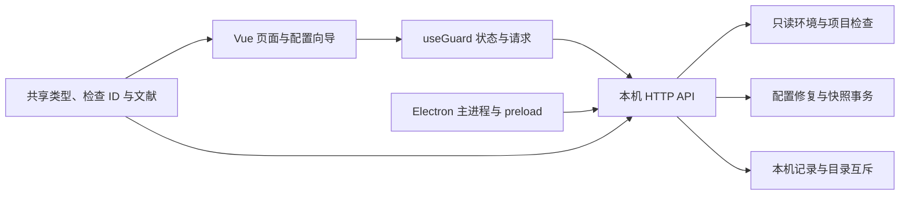

# 项目结构与扩展指南

CG Claude 是一个本地应用。Vue 展示事实、收集选择和预览修改；Node 服务负责固定范围的读取与事务；Electron 提供窗口、目录选择和原生导出。前端不直接读写文件。

## 从哪里开始读

| 任务                                       | 入口                                                                                        |
| ------------------------------------------ | ------------------------------------------------------------------------------------------- |
| 页面导航与全局弹窗                         | `src/App.vue`                                                                               |
| 页面请求、服务连接与任务状态               | `src/composables/useGuard.ts`                                                               |
| 本机配置、项目、记录、备份、偏好、使用说明 | `src/views/` 下对应视图                                                                     |
| 一键配置向导和节点状态                     | `src/components/SetupWizard.vue`、`server/workflows.ts`                                     |
| 文献搜索、阅读层次与关联导航               | `src/views/ReferencesView.vue`、`src/components/ReferenceCard.vue`                          |
| 稳定检查 ID、检测规则版本                  | `shared/diagnostic-checks.ts`                                                               |
| 环境与浏览器检测                           | `server/diagnostics.ts`                                                                     |
| CLI 版本与原生安装候选元数据               | `server/cli-diagnostics.ts`                                                                 |
| 固定系统指令与 Windows .cmd 回退           | `server/commands.ts`                                                                        |
| 进程、Claude 用户设置与静态 shell 来源     | `server/environment-sources.ts`                                                             |
| MCP 结构、字面凭据与变量引用               | `server/mcp-diagnostics.ts`、`server/projects.ts`                                           |
| 代理、认证、证书及隐私规则                 | `server/configuration-diagnostics.ts`、`server/privacy-diagnostics.ts`、`shared/privacy.ts` |
| 主动编辑连接设置与严格字段校验             | `shared/connections.ts`、`server/connections.ts`、`src/components/ConnectionEditor.vue`     |
| 本地配置静态解析与选定字段修改             | `server/configs.ts`                                                                         |
| 路径、脱敏、固定目标和原子文件操作         | `server/safety.ts`                                                                          |
| 预览校验、备份、写入与回退                 | `server/repairs.ts`、`server/snapshots.ts`                                                  |
| 本机记录、版本兼容与访问互斥               | `server/storage.ts`、`server/lock.ts`                                                       |
| HTTP 路由、输入校验、Host/Origin/token     | `server/index.ts`                                                                           |
| 文献摘要、关联检查和外链主机               | `shared/references.ts`、`src/views/ReferencesView.vue`                                      |
| 窗口、IPC、外链与原生文件对话框            | `electron/main.ts`、`electron/preload.ts`                                                   |

页面通过带类型的 props、model 和事件与 App 交互；磁盘写入保留在服务端。`useGuard` 负责请求完成后的状态同步。新增视图不要复制本机 API、互斥、预览过期或快照恢复逻辑。

## 新增一项检查

1. 先在官方或项目原文核对检查的依据、适用版本和读取范围。
2. 在 `shared/diagnostic-checks.ts` 注册稳定 ID；总检查数由列表推导，修改判断含义时更新规则版本。
3. 用独立规则函数返回 `CheckResult`。状态要区分明确问题、待确认和未检测；缺少读取权限、动态表达式或未知版本不能返回假通过。
4. 在 `server/diagnostics.ts` 的对应读取阶段加入结果。复用已读配置，避免重复执行本机命令；固定参数，不执行用户脚本。
5. 在 `shared/references.ts` 添加来源和 `checkIds`。文献会自动关联详情，Electron 的外链主机白名单也从这里生成。
6. 为重要判断和失败边界补充测试。使用 `tests/fixtures.ts` 的临时根目录，不依赖维护者真实代理、账号或配置。
7. 验证三遍检测、统计数量和历史比较。更新 README 的能力描述和 `docs/validation.md` 的实际结果。

## 扩展可修改配置

修改必须有可读预览、原始备份、预览后冲突校验和异常回退。修复只修改选择的字段，保留其他键、注释和文件权限；无法可靠解析的内容交给人工核对。完整快照还要保存缺失状态和检测偏好，恢复前再保存当前状态。

配置目标集中在 `server/context.ts`，输入 schema 在 `shared/types.ts`，字段转换在 `server/configs.ts`，事务在 `server/repairs.ts`。增加可修复字段时同步检查 ID、FixId、界面说明与恢复测试，避免前端自行拼接任意路径或命令。

连接编辑使用独立的有限字段 schema 和 plan kind，仍复用 RepairEngine 的预览、冲突校验、备份、写入与回退。保存前由 SnapshotEngine 捕获完整配置基线；普通修复端点不能消费连接预览而绕过快照。CA 元数据在预览与写入前分别验证。

报告的 `configurationFingerprint` 由固定配置的内容校验、权限和读取状态计算；bootstrap 提供当前基线。前端遇到配置已变化或缺基线的旧报告时要求重新检测。默认导出移除基线指纹，避免把配置内容的摘要标识带到外部。

## 样式与品牌

`src/styles/tokens.css` 是配色和字体变量入口。`src/style.css` 只维护顺序导入：基础、布局、检测、数据页面、弹窗、响应式、配置流程、项目/快照、阅读微调。拆分时保留了原样式节点顺序，最后的阅读调整继续覆盖前面的共用规则。文献、人工复核与历史比较有独立的页面样式文件。

新样式优先使用变量，正文用深色，说明文字保持可读对比度；长路径、变量名和证据要能换行。使用真实空状态、禁用状态和焦点样式。验证默认 Electron 窗口、较矮窗口、390px 窄窗以及键盘操作。

原创 Logo 的唯一源文件是 `public/logo.svg`。执行 `npm run icons` 生成 PNG、ICNS 和 ICO；不要分别手动编辑各个平台图标。

## 数据与兼容性

报告、备份、快照、流程与复核记录存在用户本机。原始配置可能包含凭据，不能进入截图、公开日志或仓库。报告只保存脱敏证据，导出默认继续隐藏 IP 与主机标识。

新字段要兼容旧记录：例如报告的 `ruleset` 为可选字段，旧记录可以阅读且比较时提示规则来源不完整。每份记录的时间表达实际发生的动作，导入旧复核勾选时不能伪造历史确认时间。

项目固定文件清单与元数据/内容读取在 `server/project-files.ts`。内容上限与文件描述符检查在 `server/file-reading.ts`；用户配置和项目配置共用这条读取路径。文献的环境检查 ID 与项目检查 ID 分开保存，双向跳转按范围定位。

配置事务记录原文件 mode 和实际写入后的 `afterMode`。Windows 的权限映射可能改变 POSIX 数值，因此还原必须使用观测到的写后权限核对冲突。旧备份缺少 `afterMode` 时继续使用原 mode；不要通过跳过权限检查解决平台差异。

环境详情在 `src/views/EnvironmentView.vue`，筛选模型在 `src/lib/environment-results.ts`。

错误排查内容在 `src/content/troubleshooting.ts`，交互组件在 `src/components/TroubleshootingGuide.vue`。内容只引用稳定检查 ID 和文献源 ID，由 App 接收事件并导航。帮助页不执行账号请求；没有检测报告时先打开检测选项。

环境首页由 `src/views/EnvironmentView.vue` 维护统计、连接路径、详情筛选和修复选择；App 只连接页面与本机操作。筛选模型在 `src/lib/environment-results.ts`，由 App 保存，所以跨页返回时搜索和展开状态仍保留。统计导航等待父级 model 更新后再读取目标列表，避免跳到旧筛选中的节点。详情、项目和帮助页共用 `src/lib/navigation.ts` 的焦点与滚动逻辑。

主导航和页面说明在 `src/content/navigation.ts` 注册。新增页面先补齐标题、说明和稳定 ID，再接入视图；不要在主模板继续叠加文案条件分支。

文献关联分别使用 `checkIds`、`projectCheckIds` 和带类型的 `manualItemIds`；来源单条、检查、项目与人工复核四种筛选范围明确区分。人工复核事项注册在 `shared/types.ts`，其稳定 ID 用于保存记录和双向定位。

配置与项目文本共用 `server/file-reading.ts`：读取同一文件描述符、约束实际字节数、校验读取期间变化，然后严格解码 UTF-8。BOM 不被丢弃，便于原字节还原。非法 UTF-8 和 NUL 字节产生不含原内容的 `FileReadError`；本机配置不可编辑、项目结果显示读取错误、快照列入排除项。不要通过宽松解码或猜测编码继续写入。

一键配置的每个文件基线使用 `configurationState`，同时记录内容散列、权限、可编辑状态和读取错误。预览结束、创建任务、保存快照和执行节点前都要匹配基线。修复事务的 `applyWithState` 返回写入时已知的状态，包含 Windows 实际应用的权限；流程据此更新基线，不重新读取当前文件并把外部修改当成已授权结果。普通 API 仍只返回脱敏的备份摘要。

项目命令沙箱检查在 `server/sandbox-diagnostics.ts`，接收已解析的单份设置声明，输出有限证据；不读取额外文件或执行命令。新增字段须先核对版本与配置范围，不使用未知值来推断有效隔离。项目列表与文献入口复用 `src/lib/project-results.ts` 的标签函数，区分共享项目设置与项目本地设置。

## 系统指令的边界

系统探测默认使用 `execFile` 与独立参数数组。Windows 仅在原生程序启动返回 ENOENT / EINVAL 时，允许三个固定只读指令回退到 `cmd.exe /d /s /c`：Claude 版本和 npm 的两种代理查询。项目路径、用户字段与额外参数不能进入该回退；指令已执行后失败或超时不会重跑。子进程继承隔离 HOME / USERPROFILE 与超时预算，并设置 `NoDefaultCurrentDirectoryInExePath` 防止批处理隐式优先搜索当前目录。

## 服务与认证名称的注册

`shared/usage-modes.ts` 统一定义服务 ID、显示名称与保留说明，供偏好校验、设置页、配置向导和报告使用。增加服务时更新这个注册表，避免多个页面使用不同名字。

`shared/authentication.ts` 只记录认证、提供商和上下文字段的名称，不存储值。服务端的 shell 识别与认证检查共同使用它；新增身份字段必须同时验证配置预览和报告脱敏。Foundry 的资源名称只做字面形态检查，动态表达式仍待确认。宿主管理声明不能证明实际会话已经使用该路由，需要在客户端核对。

## 检测与事务弹窗

App 负责选择记录和调用操作，ScanOptionsDialog、RepairPreviewDialog、SnapshotRestoreDialog、RestoreBackupDialog 负责各自的展示。弹窗只通过类型明确的事件请求操作，文件写入、任务互斥和冲突校验仍由 useGuard 与服务端承担。共同的模态行为由 GuardDialog 管理。修改文案或预览排版时可以只阅读对应组件，避免在 App 中查找多段事务模板。

配置目录作用范围由 `server/configuration-scope.ts` 统一判断。仅比较当前进程和默认用户文件中的声明，不执行 shell、不扩展变量、不读取外部目录。检测来源、连接编辑和自动修复共用该判断；执行阶段再次校验，避免预览后目录范围改变。Windows 按自身路径语义比较大小写与分隔符。

## 原文与文献审计

`shared/article-audit.ts` 注册原文各节要求、自动覆盖范围、修复方式和稳定检查 ID。`shared/reference-audit.ts` 记录每条文献实际采用的段落及代码位置，`ArticleAuditPanel.vue` 展示当前模式与原文的差异并接入精确跳转。新增来源时同步这两份数据，再运行 `npm run docs:audit` 生成审计文档；不要把已有检查通过当成满足原文全文。

系统时区取证在 `server/system-timezone.ts`，目标与证据判断在 `server/timezone-diagnostics.ts`。Git TLS 的布尔语义在 `server/git-tls.ts`，用户和项目作用域分别核对，include 与无效值保留未知；Git TLS 不自动改写。系统时区配置使用下面的独立授权事务。

## 时区配置事务

`server/timezone-settings.ts` 集中管理各平台的有限命令、独立系统读取、用户 TZ 与快照状态。`server/timezone-config.ts` 只转换白名单文件中的 TZ，`server/setup-timezone.ts` 负责两个节点的预览和配置。Context 暴露可注入的读写适配器；demo 和测试使用内存模拟，避免触碰真实系统和全局 process.env。

一键预览冻结有效目标及文件、时区基线。文件事务继续复用 RepairEngine；系统写入要求配置前快照，成功必须经独立读数复核。快照将时区状态与校验值保存在本地私有记录中，摘要不返回旧 TZ 原文；还原检查时区漂移，并防止失败回退覆盖第三方新时区。旧记录缺少时区字段时兼容其原范围。

最终复检通过一次性 `browserProbeId` 请求新的渲染器采样。受本机 token 与 origin 检查保护的回传接口只接受当前任务待采样的 token，可以在流程占用写入锁时接收样本；它不写配置。超时不复用旧浏览器数据，重放请求被拒绝。配置过程的授权密码由操作系统处理，不存在应用密码输入或存储字段。

## 本机记录与长操作状态

`server/record-validation.ts` 定义记录的持久化边界。读取使用 `readBoundedText` 的文件描述符和实际字节限制，拒绝特殊文件、无效编码与符号链接。记录结构错误会报告文件名并保留原文件；不得按空集合继续写入。快照的整体校验覆盖配置原文、目标路径、权限、偏好和时区状态，备份覆盖全部文件还原输入；旧记录保留原有字段并继续核对原文散列。校验用于发现损坏，不是签名或防止本机攻击者重算校验值的机制。对象键以固定顺序计算校验，数组与配置原文保留顺序。持久化校验和结构校验通过后，再为归一化的旧记录计算内存校验值；合法的迁移保存不因字段顺序或默认值补齐而失败。检测偏好按字段值比较，不依赖 JSON 的键排列。

`shared/service-status.ts` 统一检测任务与本机活动的契约。`/api/status` 只读当前内存状态，不重复读取配置；bootstrap 携带正在执行的检测。界面刷新后接回检测或配置轮询，其他本机操作仍占用界面写入锁。退出服务时跟踪完整的修改 Promise，客户端断开不能提前释放记录目录租约。

`src/lib/local-api.ts` 集中处理网络请求、短读超时和管理员授权所需的较长写入预算。`useGuard` 区分操作已确认完成与后续界面刷新失败，成功写入立即使旧报告的修复基线失效。未收到结果只报告待核对，不能宣称没有修改。

## 桌面托盘

`electron/tray.ts` 管理图标、菜单、任务状态和窗口隐藏规则。图标来自 `public/tray.svg`；生成脚本输出 macOS Template/Retina、Windows ICO 和 Linux PNG，并随应用打包。最小化和关闭窗口保留渲染器，新浏览器复检仍可回传；明确退出等待后台事务后销毁托盘。Linux 桌面不支持托盘时保留普通最小化与关闭行为。IPC 仅允许同一本机主窗口调用隐藏与目录选择。
